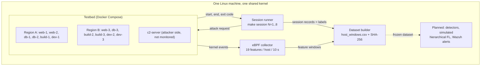

# FedShield

eBPF-enhanced hierarchical federated learning for privacy-preserving threat detection, integrated with the Wazuh SIEM.
Thesis project of Hasib Al Tahsin and Khalid Maina.

FedShield runs a testbed on one machine:

- 12 Docker containers play an organisation's Linux hosts.
- One eBPF collector turns their kernel activity into 19 counts per host per 10 seconds.
- A federated learning simulation trains a shared sparse autoencoder (plus a local Isolation Forest per host) under
  differential privacy and Multi-Krum.

The main research question is **normality poisoning**: can a compromised host teach the shared detector that the
attacker's activity is normal?

**Contents:** [Status](#status) · [How it works](#how-it-works) · [Repository layout](#repository-layout) ·
[Design](#design) · [Decision records](#decision-records) · [Setup](#setup-ubuntu-2404-or-2204-with-the-68-kernel) ·
[Commands](#commands) · [Collecting a session](#collecting-a-session) · [Testing](#testing) ·
[Rules for the data](#rules-for-the-data) · [Known limitations](#known-limitations) · [Working on it](#working-on-it)

## Status

The data side is built and verified, from simulated hosts to a labelled dataset. Detection, federated learning and
Wazuh are not written yet. Each module is rebuilt from scratch, one sprint at a time
([decision 0004](docs/decisions/0004-rebuild-from-scratch.md)). The original reference code is kept read-only at
the tag [`reference-v0`](https://github.com/khalidmaina/fedshield/tree/reference-v0).

| Sprint | Module | Folder | Status |
|---|---|---|---|
| S0 | Project skeleton, CI, docs | `.github/`, `docs/`, `Makefile` | done |
| S1 | Testbed: 12 hosts, c2-server, 5 attacks, in-host agent | `testbed/`, `fedshield/control.py` | done |
| S2 | eBPF collector, 19 features, loss and overhead per window | `collector/`, `fedshield/features.py` | done |
| S3 | Schedules, session runner, dataset builder | `fedshield/schedule.py`, `session.py`, `dataset.py` | done (control-folder fix in review, #10) |
| Campaign | Pilot session (T4), then 8 collection sessions and the data freeze | `data/` (not in Git) | next |
| S4 | Detectors: SAE, Isolation Forest, hybrid | `fedshield/models.py` | planned |
| S5 | FL core, configs, grid runner, smoke test | `fedshield/fl.py`, `configs/` | planned |
| S6-S11 | Robustness, privacy, RQ4, RQ5, RQ6 | `fedshield/` | planned |
| S12 | Wazuh and overhead | `wazuh/`, `scripts/` | planned |

Live check of the whole data path: a 16-minute version of session 1 (24 one-minute attacks, real collector and
agents) gave these results:

- 24 of 24 attacks ran cleanly.
- All 12 hosts were present, with no missing windows and 0 lost events.
- 1,112 windows were labelled and 28 ambiguous edge windows were dropped.
- Every attack window showed its attack's kernel signal, and none of the 966 benign windows did.

## How it works



Labels and features come from separate sources:

- Labels come from what each host reports about its own attacks.
- Features come from what the kernel sees.
- The dataset builder joins the two by time.

The full target design, including the federated layer, is in [docs/architecture.md](docs/architecture.md).

## Repository layout

```
fedshield/
├── README.md                  this page
├── CONTRIBUTING.md            branches, commits, pull requests, freeze points
├── Makefile                   every common command (make help)
├── pyproject.toml             package metadata, ruff and pytest settings
├── requirements.txt           pinned runtime libraries (PyTorch is installed separately, CPU build)
├── requirements-dev.txt       ruff, pytest
│
├── testbed/                   everything that runs inside the containers
│   ├── docker-compose.yml     12 hosts + c2-server; 256 MB and 0.5 CPU per host
│   ├── host/
│   │   ├── Dockerfile         one Ubuntu 24.04 image for all hosts
│   │   ├── agent.sh           main process of every host: runs the workload, starts attacks on request
│   │   └── roles/             benign workloads: web.sh, db.sh, build.sh, dev.sh (+ lib.sh)
│   ├── attacks/               simulated attacks: beacon, cred_access, miner, persistence, scan
│   ├── c2/c2.py               lab command-and-control server (beacon target, fake mining pool)
│   ├── schedules/             session_01.json … session_08.json: when each host runs which attack
│   └── control/               (run time, not in Git) one folder per host: request + status.jsonl
│
├── collector/                 runs as root with the system Python
│   ├── fedshield.bt           bpftrace program: 4 tracepoints, hosts named fs-* only
│   └── collector.py           builds 10 s windows, counts loss and overhead, writes counts only
│
├── fedshield/                 the Python package: all data (and later model) logic
│   ├── topology.py            hosts, roles, intensities, regions, attacks: one source of truth
│   ├── control.py             host-side control protocol and health checks (from outside)
│   ├── features.py            the 19 features, event parsing, clock-aligned windows
│   ├── schedule.py            8-session attack plan, concurrency limits, validation
│   ├── session.py             runs one session, records host-reported times and exit codes
│   └── dataset.py             joins features and labels, drops ambiguous/excluded windows
│
├── scripts/                   thin command-line tools that call the package
│   ├── testbed.py             testbed status; start one attack by hand
│   ├── install_bpftrace.sh    installs the verified bpftrace v0.20.2 (SHA-256 checked)
│   ├── make_schedule.py       writes testbed/schedules/
│   ├── run_session.py         preflight checks, then runs session N
│   ├── features_report.py     checks a collector run: hosts, gaps, loss, medians
│   ├── build_dataset.py       writes data/processed/host_windows.csv + manifest.json
│   ├── dataset_report.py      windows per split, host and attack; can RQ5 be evaluated?
│   ├── daily_push.sh          end-of-day push of your branch
│   └── setup_github.sh        one-time repository settings (REST API)
│
├── tests/
│   ├── unit/                  72 fast tests, run by CI (no Docker, no eBPF needed)
│   └── integration/           checks T1-T5, run by hand on the collection machine
│
├── docs/
│   ├── architecture.md        target design: layers, federated layer, proposal vs testbed
│   ├── decisions/             decision records 0001-0009 (why things are the way they are)
│   ├── data_protocol.md       how the 8 sessions are run, checked, backed up and frozen
│   ├── experiment_register.md one row per experiment result cited in the thesis
│   └── daily_log.md           short daily research log
│
├── data/                      (not in Git: large and private)
│   ├── features/              features_*.jsonl (windows), collector_stats.jsonl (loss, overhead, toolchain)
│   ├── labels/                session_NN.json (what each host reported)
│   └── processed/             host_windows.csv + manifest.json (the dataset)
├── results/summaries/         small result tables and figures that are kept in Git
├── thesis/                    thesis sources
└── .github/                   CI workflow, weekly smoke run, issue and PR templates
```

Planned folders: `configs/` (experiment grids, S5) and `wazuh/` (rule 100200 and log reading, S12).

## Design

### Platform

- Ubuntu installed natively (24.04, or 22.04 with the 6.8 kernel), with Docker Compose. No VM, WSL2 or Kubernetes
  ([0001](docs/decisions/0001-native-ubuntu-docker-compose.md)).
- All hosts share the machine's kernel, which is what lets one eBPF collector observe all 12.
- Every session is collected on the same machine with the same pinned toolchain
  ([0007](docs/decisions/0007-toolchain.md), [0008](docs/decisions/0008-web-loopback-and-one-collection-machine.md)).

### Testbed

Each role runs at three workload intensities (1, 2, 3), giving hosts `fs-web-1` to `fs-dev-3`. The roles are split
across two regions of six, which matter once federated learning is built.

| Role | Benign workload | Typical kernel activity |
|---|---|---|
| web | Serves static pages; requests pages from itself (127.0.0.1) and a peer | TCP connections (curl), file reads, log writes |
| db | SQLite inserts, queries, backups and clean-ups | File opens and writes; few processes; almost no network |
| build | Compiles and runs a small C program; sometimes archives it | Many short-lived processes (make, gcc, cc1, as, ld) |
| dev | Browses files, runs scripts, edits, lists processes | A mix of everything, many /proc reads |

The attacks are harmless simulations confined to the lab, each with a distinct kernel signature:

| Attack | What it does | Main signal |
|---|---|---|
| beacon | Polls the c2-server every 2-4 s with curl; runs only whitelisted harmless commands | Connections to an uncommon port |
| cred_access | Reads account files, looks for SSH keys (a planted fake key) | Opens of /etc/shadow and key files |
| miner | A renamed python3 in a hidden /tmp folder burns CPU in bursts, sends "shares" to a fake pool | Execs from /tmp, pool-port connections |
| persistence | Plants a hidden script, a cron entry and a .bashrc line; cleans up at the end | Writes under /etc/cron.d, execs from /tmp |
| scan | TCP connect checks against other lab hosts on common ports | Hundreds of connections, many to uncommon ports |

**Beacon** is the target attack for normality poisoning (RQ5). On a web host it hides inside normal curl traffic;
only its port gives it away.

**The in-host agent** ([0005](docs/decisions/0005-attacks-started-by-in-host-agent.md)) works like this:

- `agent.sh` is each host's main process. It starts the workload and watches `/control/<host>/request`.
- It runs each requested attack as its own child process.
- It appends `started` and `finished` lines to `status.jsonl`, with times measured inside the host and the exit code.

The reference design used `docker exec` instead, which differs in three ways:

- The attack's parent would be the container runtime, a trace no real intrusion leaves.
- It recorded nothing about whether the attack actually ran.
- The harness's own commands would show up in the telemetry. The agent waits with bash built-ins only and checks
  health from outside (`docker inspect`, `docker top`), so it adds nothing. Measured: 0 opens and 0 execs in 20 s
  across 12 idle agents.

Two further rules:

- The agent pins `LC_ALL=C`, so status times never use a decimal comma.
- Control folders belong to the user who started the testbed ([0009](docs/decisions/0009-control-folder-ownership.md)).

### eBPF collector

[0006](docs/decisions/0006-collector-design.md) records the design.

- **Tracepoints:**
  - `sys_enter_execve`: programs started
  - `sys_enter_openat`: files opened, with their flags
  - `inet_sock_set_state`: outgoing TCP connections
  - `sched_process_exit`: process exits, main thread only, so threads do not inflate the count
- **Kernel filter:** only processes whose UTS hostname starts with `fs-` are seen; the machine and the c2-server
  never are.
- **Streaming:** bpftrace prints one short line per event, and Python builds the windows. This is safe at the
  measured rate (about 1,600 events/s idle, about 2,100 under 5 attacks, 0 lost).
- **Counts only on disk:** paths, addresses and command names live in memory for one window. A unit test fails if any
  raw value reaches a file.
- **Windows:** windows are aligned to the clock (…:00, …:10), and only complete windows are written. Each window
  closes 2 s after it ends, and later events are counted as `late`.
- **Loss:** bpftrace's "Lost N events" messages (on stdout) are charged to the window they arrive in.
- **Overhead per window:** CPU of the collector and of bpftrace, plus the kernel time spent in the eBPF programs
  (`kernel.bpf_stats_enabled`). Under 5 attacks this was 3.4% + 3.0% + 2.4% of one core.
- **Toolchain record:** each run records its bpftrace version, kernel, OS and Python in `collector_stats.jsonl`.

The 19 features, per host per 10 s window:

| Group | Features |
|---|---|
| Programs started (5) | `exec_count`, `exec_unique_paths`, `exec_from_tmp`, `shell_exec`, `net_tool_exec` |
| Files opened (8) | `open_count`, `open_write_count`, `open_etc`, `open_sensitive`, `open_tmp`, `open_proc`, `open_unique_paths`, `cron_write` |
| Outgoing TCP connections (4) | `conn_count`, `conn_unique_daddr`, `conn_unique_dport`, `conn_uncommon_port` |
| Processes (2) | `exit_count`, `unique_comm` |

The fixed lists behind the features are in `fedshield/features.py`:

- Sensitive files: /etc/shadow, /etc/gshadow, /etc/sudoers, /root/.ssh/ and SSH key files. /etc/passwd is left out
  because ordinary tools read it constantly.
- Common ports: 22, 53, 80, 443, 3306, 5432 and 8080.
- Temporary folders: /tmp, /dev/shm and /var/tmp.

### Sessions, schedules and labels

The data is collected in eight 2-hour sessions. The split comes from the session, so training data always comes
before test data in time ([0003](docs/decisions/0003-attack-rotation.md)).

| Sessions | Split | Attacks per host |
|---|---|---|
| 1-4 | train | 8: beacon twice (different sessions), each other attack at least once |
| 5 | val | beacon + 1 other |
| 6-7 | test | beacon + 3 others (val + test cover all 5 attacks for every host) |
| 8 | holdout | beacon + 1 other; never used to train or tune anything (SIEM replay, RQ7) |

The schedule rules:

- Each host gets 2 attacks per session, one in each half, 8 minutes each.
- Start times are random quarter-minutes from seed 7, and the first, middle and last 6 minutes are quiet.
- At most 4 attacks run at once and never two miners, so one attack's CPU load does not distort other hosts.
- Any host can play the compromised one in RQ5, and all 11 others can be evaluated, in both regions.

`make session` refuses to start if any of these is true:

- the testbed is unhealthy
- a control folder is missing or not writable
- the collector is not writing
- the session was already recorded

Labels come from the times the hosts report, not from the scheduler's clock:

| A 10 s window that… | becomes |
|---|---|
| overlaps an attack by at least half | that attack's label |
| overlaps no attack | `benign` |
| overlaps an attack by less than half | dropped (ambiguous) |
| touches an attack that failed, never finished or was never answered | dropped (excluded), never mislabelled |

### Dataset

`make dataset` writes `data/processed/host_windows.csv`, one row per host per window, with these columns:

- `session`, `split`, `host`, `role`, `intensity`, `region`, `window_start`
- `label`, `lost_events`
- the 19 features

`manifest.json` records the sessions used, the counts per split and label, the dropped windows, and the file's
SHA-256. Experiments replay this frozen file, so every result traces back to one exact dataset.

### Federated learning (planned)

- Simulated in one process ([0002](docs/decisions/0002-simulated-fl-two-regions.md)), with 12 clients and
  **2 regions of 6**. That is the smallest split in which Multi-Krum tolerates one Byzantine client per region
  (n ≥ 2f + 3).
- Each round, every host trains the shared sparse autoencoder on its own windows. Its Isolation Forest never leaves
  the host.
- Each region aggregates with Multi-Krum (f = 1), and a global coordinator takes a sample-weighted average.
- "Track B" clips and noises updates for differential privacy.
- Runs are exactly reproducible from a seed. Bytes per round are computed, not measured.
- A trained model will score new windows live and send alerts to Wazuh (rule 100200).

## Decision records

Every design choice that matters has a short note in [docs/decisions/](docs/decisions/) with its context, options,
decision and measured evidence.

| No. | Decision |
|---|---|
| [0001](docs/decisions/0001-native-ubuntu-docker-compose.md) | Native Ubuntu with Docker Compose; no VM, WSL2 or Kubernetes |
| [0002](docs/decisions/0002-simulated-fl-two-regions.md) | Federated learning simulated in one process; two regions of six |
| [0003](docs/decisions/0003-attack-rotation.md) | Eight sessions split by session; two attacks per host per session; every host evaluable for RQ5 |
| [0004](docs/decisions/0004-rebuild-from-scratch.md) | Rebuild module by module; the reference code is a read-only guide |
| [0005](docs/decisions/0005-attacks-started-by-in-host-agent.md) | Attacks started by an in-host agent; the harness leaves no trace in the telemetry |
| [0006](docs/decisions/0006-collector-design.md) | Collector streams events, writes counts only, measures loss and overhead per window |
| [0007](docs/decisions/0007-toolchain.md) | bpftrace 0.20.2 (official static build) on Ubuntu 22.04 or 24.04 with kernel 6.8 |
| [0008](docs/decisions/0008-web-loopback-and-one-collection-machine.md) | Web workload uses 127.0.0.1; all sessions collected on one machine |
| [0009](docs/decisions/0009-control-folder-ownership.md) | Control folders belong to the user; the session runner checks them first (#10) |

## Setup (Ubuntu 24.04, or 22.04 with the 6.8 kernel)

```bash
sudo apt update && sudo apt install -y git make curl python3-venv python3-dev build-essential \
    linux-headers-$(uname -r) docker.io docker-compose-v2
sudo usermod -aG docker $USER          # then log out and back in

git clone git@github.com:khalidmaina/fedshield.git ~/fedshield && cd ~/fedshield
make install-bpftrace                  # the verified bpftrace v0.20.2 (not the apt package; decision 0007)
python3.12 -m venv .venv && source .venv/bin/activate
make install                           # PyTorch (CPU), pinned libraries, dev tools
make lint && make test
```

Python versions:

- The venv needs Python 3.12. It is built in on 24.04; on 22.04, install `python3.12` separately.
- The collector runs as root with the system Python, which may be older (3.10 on 22.04).
- The Makefile uses `.venv` automatically, even when it is not activated.

If bpftrace reports that a `syscalls` tracepoint is not found, mount tracefs once:
`sudo mount -t tracefs nodev /sys/kernel/tracing`.

## Commands

| Command | What it does |
|---|---|
| `make help` | List all commands |
| `make install` | Install PyTorch (CPU), runtime and dev libraries into the venv |
| `make lint` / `make test` | Ruff and the unit tests (what CI runs) |
| `make install-bpftrace` | Install the verified bpftrace v0.20.2 |
| `make testbed-up` / `make testbed-down` | Build and start / stop the 12 hosts and the c2-server |
| `make testbed-status` | Check all 13 containers from outside |
| `make collect DURATION=7500` | Run the eBPF collector (sudo) into `data/features/`; `0` = until Ctrl+C |
| `make features-report` | Check the latest collector run: hosts, gaps, loss, medians |
| `make schedules` | Regenerate `testbed/schedules/` (they are committed; normally not needed) |
| `make session N=1` | Run collection session N (the collector must be running) |
| `make dataset` | Build `data/processed/host_windows.csv` and `manifest.json` |
| `make dataset-report` | Windows per split, host and attack; RQ5 check |

## Collecting a session

[docs/data_protocol.md](docs/data_protocol.md) has the full checklist and the session log.

1. Make sure you are on an up-to-date, clean `main`: `git switch main && git pull`.
2. Start the testbed with `make testbed-up`, wait 2 minutes, then check that `make testbed-status` shows 13/13
   healthy.
3. In terminal 1, start the collector: `make collect DURATION=7500`. That is 125 minutes, which covers the 2-hour
   session plus start-up.
4. About 30 s later, start the session in terminal 2: `make session N=<n>`.
5. When the session ends, all 24 attacks must have run cleanly.
6. After the collector stops, run `make features-report` and check for 12/12 hosts, no gaps, and lost events 0 (or
   noted).
7. Back up `data/features/` and `data/labels/` to two places.

Run the sessions in order, 1 to 8, all on the same machine. Before the campaign, run the pilot session (T4), then
delete its data.

## Testing

- **Unit tests** (`tests/unit/`, 72 tests): features, windows, the collector with a fake bpftrace, the agent
  (including a comma-decimal locale), the control protocol, schedules, sessions and labelling.
- **CI** (GitHub Actions, job `checks`): lint, unit tests and the compose file check on every pull request. `main`
  is protected by this check. A smoke test on synthetic data is added with the FL core (S5).
- **Integration checks** ([tests/integration/README.md](tests/integration/README.md)): run by hand on the
  collection machine, because CI has no eBPF or live containers. Any change to `testbed/`, `collector/` or
  `fedshield/features.py` runs the matching check and reports it in its pull request.

| Check | What passes |
|---|---|
| T1 | Testbed comes up healthy: 13/13 containers |
| T2 | Collector sees every host and only the hosts; no gaps, no loss |
| T3 | Each attack runs and shows its kernel signal |
| T4 | Pilot session: a full session end to end, before the campaign |
| T5 | The harness adds nothing to the telemetry |

## Rules for the data

- **Collector freeze:** after Sprint 2, `collector/`, `fedshield/features.py`, `testbed/host/` and
  `testbed/attacks/` change only through a new decision note. A change would make collected sessions incomparable.
- **Data freeze:** after session 8 the dataset hash is written into `docs/data_protocol.md`. Every experiment
  records it.
- **Session 8 is the holdout:** it is never used to train or tune anything.
- **Data stays on the machine:** `data/` and `results/` are not in Git, apart from `results/summaries/`.
- **Results come from real data only:** the [experiment register](docs/experiment_register.md) takes rows from real
  collected data or CICIDS2017, never synthetic data.

## Known limitations

State these in the thesis:

- **Containers are not real hosts.** They share one kernel and lack system services, so their "normal" behaviour is
  simpler.
- **The attacks are simulations.** They are started by the agent rather than descending from a compromised service.
- **Coverage is partial.** Only `openat` opens and TCP connections are traced; `open`, `openat2` and UDP are not.
- **Overhead is shared.** It is measured for one collector serving 12 containers; per-host overhead for RQ7 needs a
  separate single-host measurement.
- **Federated learning is simulated.** Communication cost is computed, not measured.

## Working on it

Read [CONTRIBUTING.md](CONTRIBUTING.md). In short:

- One branch per issue, Conventional Commits.
- Every pull request is reviewed by the partner, and CI must pass.
- The freeze points protect the data and the results.
- The reference code is read, never copied.
