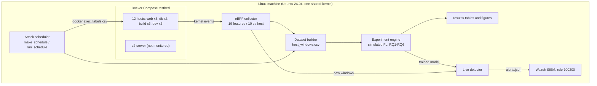
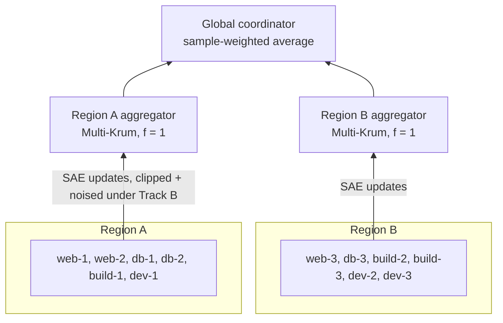

# Architecture

FedShield is described in the proposal as four logical layers (telemetry, local detection, hierarchical FL, SIEM).
This repository realises them as a **testbed on one Linux machine**: 12 Docker containers play the hosts, one eBPF
collector watches all of them through the shared kernel, and federated learning runs as a simulation in one Python
process. Decision notes 0001 and 0002 explain why.

## System on one machine

Three paths run through it: **collection** (scheduler, collector, dataset builder), **experiments** (the dataset is
replayed hundreds of times with different settings and seeds) and **live alerting** (only needed for RQ7).

## Federated layer inside the experiment engine

Each round every host trains the shared sparse autoencoder on its own windows; its Isolation Forest never leaves the
host. The new global model goes back to all 12 hosts. With `n = 6` per region, Multi-Krum tolerates `f = 1`
(`n >= 2f + 3`).

## Proposal vs testbed

| Part | Proposal (logical design) | This testbed | State in the thesis |
|---|---|---|---|
| Host | Real Linux machine, own kernel | Container on a shared kernel | Containers lack system services, so "normal" is simpler |
| eBPF collector | One per host | One for all 12, split by UTS hostname `fs-*` | Overhead measured separately per host (RQ7) |
| Local training | On each host | Simulated, one client per host | Results depend only on data and maths, not on placement |
| Aggregators | Separate servers | Functions in the same process | Bytes per round computed, not measured |
| Alerts to Wazuh | Agent per host | One file read by the manager | Latency covers scoring + ingestion |
| Model during detection | Retrained continuously | Frozen, trained beforehand | Deliberate separation (proposal Section 4.4) |

## Where the code lives

| Folder | Role |
|---|---|
| `testbed/` | Everything that runs inside containers: host roles, attacks, c2-server |
| `collector/` | bpftrace script + collector process (system Python, sudo) |
| `fedshield/` | All data and model logic: features, data split, models, aggregation, privacy, attacks, poisoning, FL |
| `scripts/` | Thin command-line tools that call the package |
| `configs/` | `base.yaml` + one grid per research question |
| `wazuh/` | Rule 100200 and the log-reading block |
